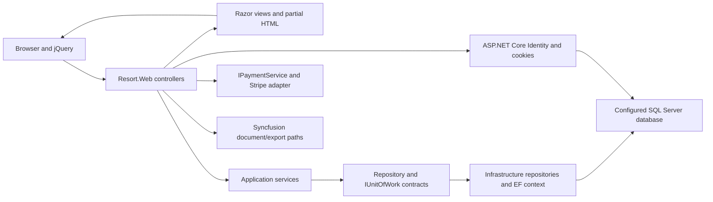
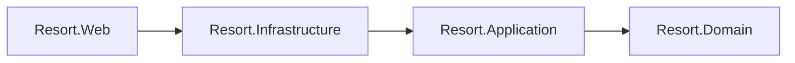
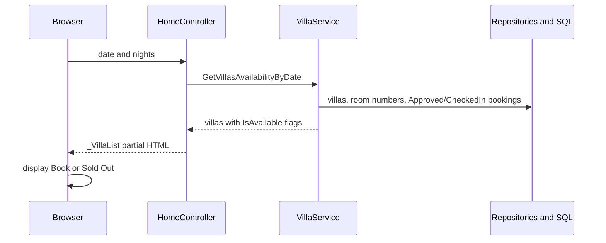

# Architecture: server-rendered availability and booking

[Walkthrough](WALKTHROUGH.md) · [Repository overview](../README.md)

This map follows the checked-in MVC implementation. The project has no separate JSON Web API in this scenario.

## Project references

The csproj references form this chain:

These are compile-time references; the first diagram shows runtime calls. Infrastructure implements the application interfaces and Program registers the concrete services. This is a description of the repository's organization, not a claim that every dependency obeys a strict clean-architecture boundary.

## Choices visible in the code

| Choice | Code path and consequence |
|---|---|
| Server-rendered pages | [HomeController](../Resort.Web/Controllers/HomeController.cs) returns a HomeVM; [Index](../Resort.Web/Views/Home/Index.cshtml) posts the selected date/nights with jQuery and replaces the villa list with returned HTML. |
| Service-level availability | [VillaService](../Resort.Application/Services/Implementation/VillaService.cs) loads villa numbers and Approved/CheckedIn bookings, then calls [VillaRoomsAvailable_Count](../Resort.Application/Common/Utility/SD.cs) for each villa. Pending bookings are not included in that read query. |
| Repository/unit-of-work boundary | [IUnitOfWork](../Resort.Application/Common/Interfaces/IUnitOfWork.cs) groups repository access; [UnitOfWork](../Resort.Infrastructure/Repository/UnitOfWork.cs) saves through ApplicationDbContext. This does not by itself create a reservation lock across concurrent requests. |
| Booking amount recalculation | [BookingController](../Resort.Web/Controllers/BookingController.cs) obtains the villa and calculates TotalCost as villa.Price × Nights for preview and submission. The POST also checks availability before storing the booking. |
| Separate payment adapter | IPaymentService prepares/creates a Stripe session after the booking is created, then the controller stores payment identifiers and returns 303 to the checkout URL. There is no cross-system transaction implied by this sequence. |
| Customer registration | [AccountController](../Resort.Web/Controllers/AccountController.cs) forces the Customer role and signs in only after assignment succeeds. [Registration tests](../tests/Authorization.Tests/RegistrationSecurityTests.cs) cover elevated-role requests and failed assignment. |

## Read scenario and payment boundary

Selecting Book opens the authenticated FinalizeBooking GET preview. Submitting that form is a different operation: it writes a booking and invokes Stripe. The [walkthrough](WALKTHROUGH.md) stops before submission.

## Limits to keep visible

- [Program](../Resort.Web/Program.cs) calls [DbInitializer](../Resort.Infrastructure/Data/DbInitializer.cs) on startup. It can migrate and seed roles plus a fixed demonstration administrator account. Review this before running; account/credential literals are intentionally not reproduced here.
- Administrative navigation is not evidence of an ADMIN-only policy on every endpoint. For example, VillaController currently has a class-level Authorize requirement; this guide does not certify role restrictions on its management actions.
- The availability helper is an in-process count calculation, not a transactional booking lock or proven allocation algorithm for all overlapping-date cases.
- Existing registration tests do not cover booking ownership, inventory concurrency, payment/refund integration or document generation.
- Syncfusion export/report paths and Stripe need their own configuration/licensing/integration review. None is exercised by this documentation change.

Configuration and startup requirements are in [README](../README.md#requirements-and-configuration) and [SECURITY-SETUP.md](../SECURITY-SETUP.md).
