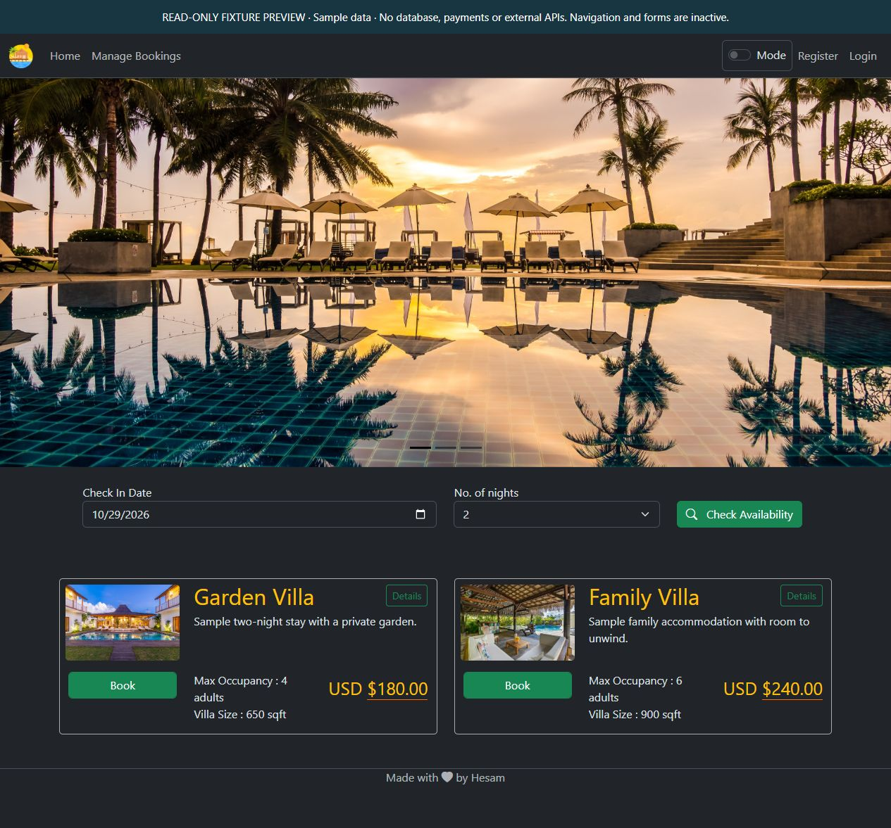

# Read-only fixture preview



This screenshot was captured from the local preview host, which renders the application's existing Razor home view and shared layout with clearly labeled sample data. It is not a screenshot of a deployed service or a completed payment/booking transaction.

From the repository root, with a .NET 10 SDK:

```powershell
dotnet run --project tools/Preview/Preview.csproj --no-launch-profile
```

Open `http://127.0.0.1:8810`. Stop the process with Ctrl+C.

The separate entry point clears configuration sources, binds to loopback, registers only the preview controller, and supplies models directly. The original application's Program.cs, service adapters, database initialization and cloud consumers are not executed. POST requests return 405; application navigation is intentionally unavailable. `/preview-info` returns the preview boundary as JSON. Data-protection keys are ephemeral. Existing layout CDN links remain, so styling is not guaranteed to be fully offline.

This host demonstrates the actual views. Use the isolated regression suite for authorization/business behavior and the README's original startup procedure for a separately configured development deployment.
